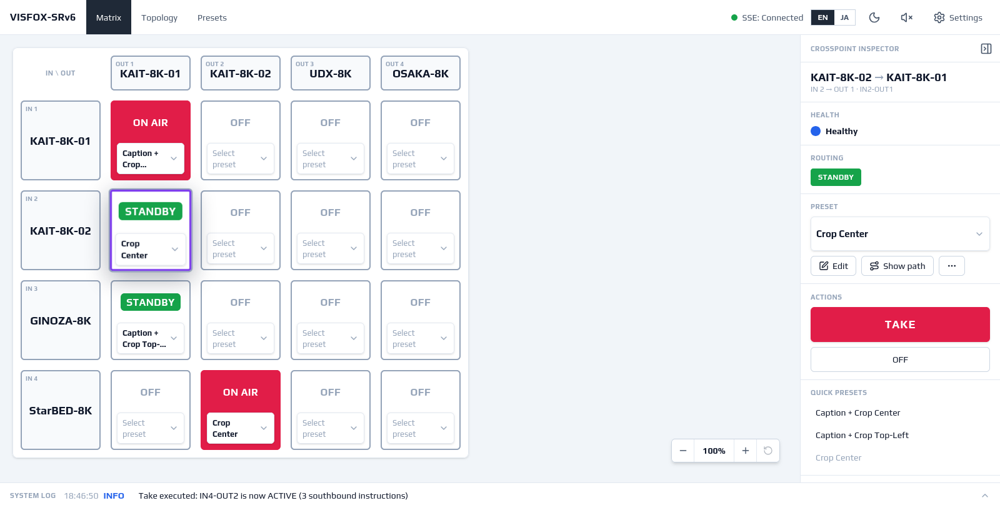
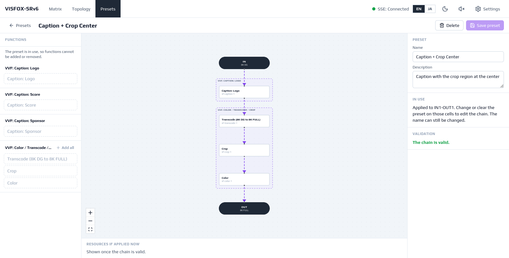
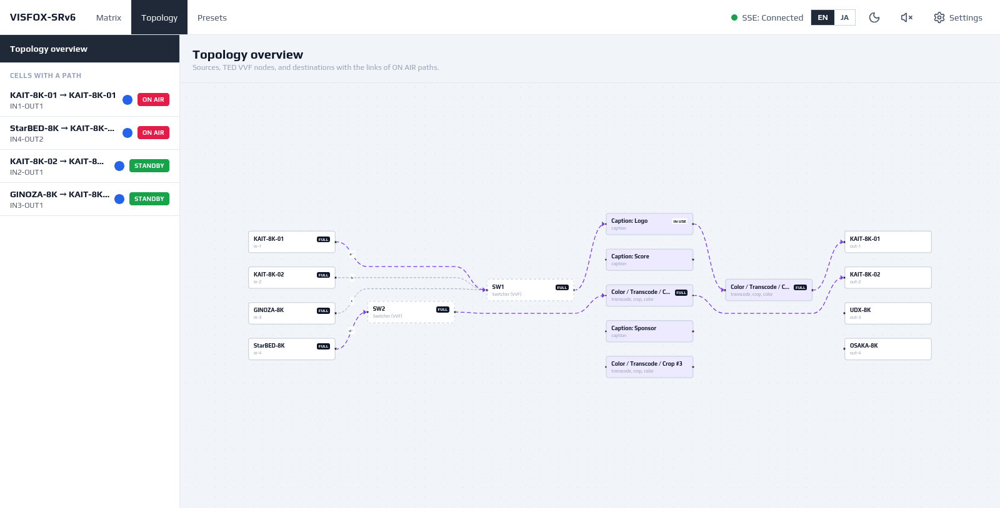
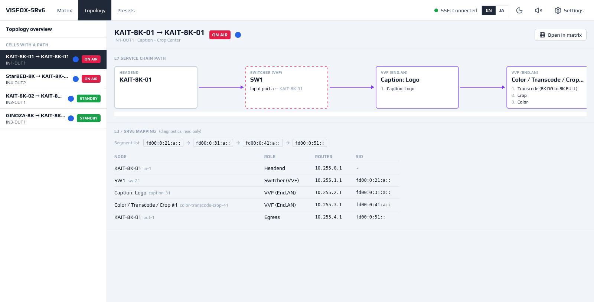
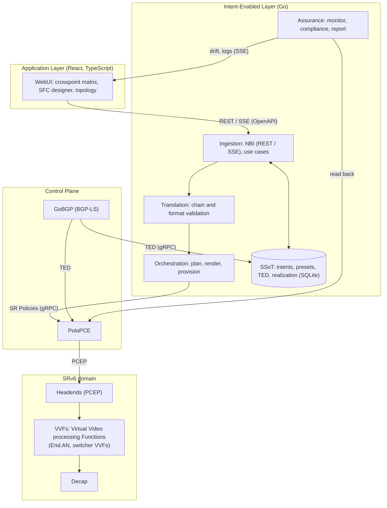

# VISFOX-SRv6 🦊

**Video Intent-driven Service Function-chain Orchestrator & eXecutor on SRv6 infrastructure**

VISFOX-SRv6 lets video operators run live 8K video over an SRv6 network by saying *what* they want,
not *how* to forward it. An operator picks which input goes to which output and which video functions
(caption, color, transcode, crop) it passes through. VISFOX turns that intent into SRv6 Service
Function Chains (SFC) and places them on the network's VVFs. A **VVF (Virtual Video processing
Function)** is a video function on the SRv6 network that handles SRv6 itself (SR-aware, End.AN): it
processes the stream (caption, color conversion, ...) or, as a switcher VVF, selects one of several
streams. VISFOX then installs the SR Policies through a PCE and keeps checking that the network still
matches the intent.

It follows the Intent-Based Networking reference model of [RFC 9315](https://www.rfc-editor.org/rfc/rfc9315):
an Application Layer where intents are expressed, and an Intent-Enabled Layer (IEL) that fulfills and
assures them.

## Highlights

- **Declarative operation.** A crosspoint matrix (IN x OUT) of intents, a drag-and-drop SFC designer and
  live function parameters. The WebUI never sees an SRv6 SID; it only reads them back for diagnostics.
- **IEL along RFC 9315.** Intent ingestion, translation, orchestration (plan / render / provision) and
  assurance, each in its own Go package, with the validated intents held as the Single Source of Truth
  (SSoT).
- **Real control plane.** SR Policies go to [PolaPCE](https://github.com/nttcom/pola) over gRPC and reach
  the headends over PCEP. The topology (TED) can be learned over BGP-LS from GoBGP and goes through a
  YANG model (RFC 8345) before the orchestrator sees it.
- **Resources as pools.** VVF nodes, switcher inputs / outputs and headend unicasts are uniform resource
  pools; a shortage is always the same kind of issue, and the IEL proposes which STANDBY cells to release.
- **Self-healing.** A failed change rolls back to the last known good config (LKG). At startup and on a
  set interval the IEL reads the SR Policies and the switcher inputs back from the network and repairs any
  drift, or only reports it (a setting in the GUI).
- **Verified switching.** A test model replays every matrix operation against a network model and checks,
  after each southbound instruction, that no picture breaks, and compares every refusal with an
  exhaustive oracle of the possible allocations.

## Screenshots

Taken on the lab network of the Quick start (TED from BGP-LS, SR Policies through PolaPCE).

**Crosspoint matrix.** Each cell is an intent: the preset an IN carries to an OUT, ON AIR or STANDBY.
The inspector shows the selected cell and takes it on air.



**SFC designer.** A preset is a logical chain of functions; functions that share one VVF are grouped and
placed together. The IEL validates the chain.



**Topology overview.** Sources, VVFs and destinations, with the paths of the cells on air.



**Real path of a cell.** The service chain path and, read only, the Segment List and SIDs the IEL
installed through PolaPCE.



## Architecture



See [docs/architecture.md](docs/architecture.md) for the layers, the data flow and the switching rules.

## Quick start

Requirements: Docker with Compose.

```bash
# WebUI with the in-browser mock IEL
docker compose up --build -V
open http://localhost:15173

# WebUI with the Go IEL, dry run: every southbound instruction is logged, nothing is sent
VITE_API_MOCK=false VISFOX_DRY_RUN=true docker compose up --build -V

# Local C-Plane lab: PolaPCE, GoBGP, a stand-in BGP-LS speaker and four stand-in headends
VITE_API_MOCK=false VISFOX_SR_POLICY=polapce docker compose --profile cplane up --build -V
docker compose exec visfox_headend_a wget -qO- localhost:8080/policies

# The lab network: the IEL learns its TED over BGP-LS, shared with PolaPCE
VITE_API_MOCK=false VISFOX_NETWORK=lab VISFOX_SR_POLICY=polapce \
  docker compose --profile cplane up --build -V
```

The networks you can run (`VISFOX_NETWORK`) and the lab are described in
[docs/networks.md](docs/networks.md).

## Repository layout

```text
visfox-srv6/
|-- api/openapi.yaml      # Contract between the Application Layer and the IEL (REST / SSE)
|-- application/          # Application Layer: React 18, TypeScript, Vite, Tailwind, React Flow
|   `-- src/mocks/        #   Stateful MSW mock IEL (runs the same rules in the browser)
|-- iel/                  # Intent-Enabled Layer: Go, Echo, SQLite
|   |-- cmd/visfox/       #   Entrypoint
|   |-- internal/         #   ingestion, translation, orchestration, sbi, assurance, ssot, domain
|   |-- config/           #   Network operator configs (SID rule, IN / OUT, wiring, limits)
|   |-- db/               #   TED sources, VVF catalog, presets, schema
|   `-- yang/             #   YANG model of the TED (RFC 8345 + visfox-srv6-ted)
|-- infra/
|   |-- nginx/            # Single-port gateway (WebUI and /api)
|   `-- cplane/           # Local C-Plane lab: PolaPCE, GoBGP, BGP-LS speaker, stand-in headends
`-- docker-compose.yaml
```

## Development

```bash
# API contract
npx @redocly/cli lint api/openapi.yaml

# Intent-Enabled Layer
cd iel && go test -race ./... && golangci-lint run

# Application Layer
cd application && npm run check && npm run lint && npm run test
```

## Features

VISFOX-SRv6 is under active development (v0.x). What works today:

| Area | Supported |
| :--- | :--- |
| Operation | Crosspoint matrix: assign a preset to a cell, Take (one ON AIR per OUT), stop output, clear; the reasons a cell cannot be taken; releasing STANDBY cells of the same input when its streams run short |
| Presets | SFC designer with the chain rules served by the IEL (VVF bundles, execution order, video formats); presets created, changed and deleted through the API and translated into paths on every assignment; live function parameters (color sliders, crop position controller) |
| Visibility | Topology overview (live and STANDBY feed links, resource pool usage), real path of a cell with its Segment List, log bar, settings, live sync over SSE; English / Japanese, light / dark |
| Topology | TED from a static seed or from BGP-LS (GoBGP, followed while the IEL runs), through a YANG model (RFC 8345); SID interpretation rules for the testbed and for structured RFC 8986 SIDs |
| Planning | Resource pools (VVF nodes, switcher inputs / outputs, headend streams); ways through cascaded switchers computed as a graph; hot and cold standby |
| Southbound | SR Policies through PolaPCE (gRPC, PCEP): the IEL's Segment Lists, validated against a TED shared over BGP-LS, or paths PolaPCE computes through the IEL's SIDs as waypoints; a dry-run driver that logs instead of sending |
| Assurance | Rollback to the last known good config when a change fails; SR Policies (PolaPCE) and switcher inputs read back at startup and on an interval, drift repaired or reported |
| Quality | A switching test model run on every `go test`: no picture break at any southbound step, refusals checked against an exhaustive allocation oracle |
| Development | An in-browser mock IEL with the same rules; a local C-Plane lab (PolaPCE, GoBGP, BGP-LS speaker, stand-in headends) |

With limits:

| Area | Limit |
| :--- | :--- |
| VVF control | There is no M-plane component that manages the SR functions yet, so the IEL provisionally treats the REST API of the routers the VVFs run on as the M-plane. It selects the input of a switcher VVF that way (not tried on hardware yet); of processing VVFs it sets crop and color (caption is a fixed image for now, transcode has no parameters) |
| Lab | The stand-in headends accept and report SR Policies but forward no packets |
| Topology | A new IN or OUT needs a change of the network operator config and a restart (BGP-LS changes of VVF nodes and switchers are followed) |
| Path computation | PolaPCE computes the paths only when enabled (`VISFOX_PCE_PATH=dynamic`). Pola v1.4.0 takes a node's first SRv6 SID as its node segment, so it reads a TED with node SIDs only (`VISFOX_POLA_TED=node` in the lab) and cannot validate the IEL's SIDs |
| Branches | Ways through replicating VVFs (RFC 9524) are planned but not rendered |

Not yet:

- Telemetry, latency SLAs and telemetry-driven drift detection (the mock IEL simulates telemetry).
- The designer's resource estimate from the Go IEL (mock only).
- BGP FlowSpec, a VIM (OpenStack), the channel-strip view and WebSocket transport.

## Contributing

Issues and pull requests are welcome: see [CONTRIBUTING.md](CONTRIBUTING.md). Report security
problems privately, as described in [SECURITY.md](SECURITY.md).

## License

Copyright 2026 Ryuta Futami. Licensed under the [Apache License 2.0](LICENSE) (see also
[NOTICE](NOTICE)). The bundled fonts (Play, M PLUS 2) are under the SIL Open Font License,
and the IETF YANG modules under the license stated in each module.
